# 京张文明星座 · BM0

**从海淀文明，到智能共同体。** 英文识别名为 **Jing-Zhang Civic Constellation / BENCHMARK ZERO**，对外邀请语为 **Bring a question. Make it real.** BM0 是本方案借用 bench mark 语义创作的零号基准符号，不是现存测量标志或已注册商标。我们希望人们记住一处真实可用的场所：在园中读书，在长桌旁争论，转身便能把想法做出来，再带回来接受检验。公共校准制度是其中的工作方法，不是城市生活的全部 [source:AGENT-TASKBOOK]。

京张、园林与学院之间有具体的历史联系。清华校史馆记载，清华园车站的设立服务于清华学堂的运料和乘车需求，铁路也便利了西郊园林游览。今天的设计据此提出“知识、制作、公共生活相互抵达”的走廊，而不把青龙桥人字形线路误画成海淀现场遗存。“勘测—定标—分岔—试验—维护”是当代创作的方法链，不是未经考证的历史施工顺序 [source:HD-TSINGHUA-STATION]。

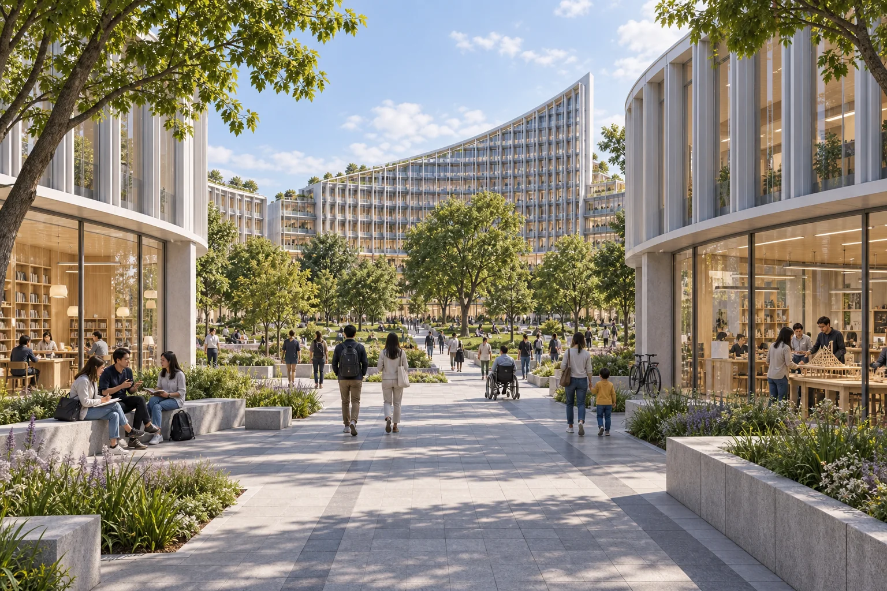

## 海淀文明如何成为空间，而不只是说明文字

### 四重根系，一条京张

三山五园是海淀空间气质的重要来源，但不把皇家建筑复制成科技景区。园林的行游、框景、疏密和留白转译成工作与散步相邻的庭院；具体视线、树木和水文仍需现场调查，不假设每处都能看见西山。燕园从历史园林转化为近现代校园的叠合，为“园中求知”提供了可核查的地方参照；北大1952年迁入燕园，五四时期原校址不能移置到这里 [source:HD-GARDEN-PLAN] [source:HD-YANYUAN]。

中关村的价值也不只是企业密度。其电子一条街的实践、科研与市场的相遇、对创新和失败的包容，启发我们把制作、维修与公开复核放到可见的一层。下表右侧均为本方案的设计判断，不是史料中的既有设施或已达成的机构合作 [source:HD-ZGC-CULTURE]。

| 地方依据 | 空间选择与落位 | 日常制度 | 移除地方条件会失去什么 |
| --- | --- | --- | --- |
| 三山五园及海淀园林体系 | 原点西侧静园、连续绿廊的疏密庭院；留白优先，不仿古 | 不消费也能坐下读书；静园不设屏幕与扩音 | 失去山水园林与知识生活相邻的空间谱系，需重做景观叙事 |
| 学院、园林与近现代校园的叠合 | 原点评议长桌与阅读庭相邻，朝向公共穿行通道 | 每周可质疑的公开讨论，记录不同意见与证据；不以学历排除参与 | 失去与海淀校园知识网络协作的内容来源；不是换地名可保留的课程表 |
| 中关村的制作与试错文化 | 众智园制作前廊，原点小型维修工位连接科技服务翼 | 零件借用、开源维护、失败作品返修；不以融资额作为作品荣誉 | 失去本地研究—工程—服务关系，须另建供应与指导网络 |
| 京张铁路与清华园站的学校交通史 | 南北遗址公园骨架连接三处重点区，东西通道接日常街区 | 标识记录问题、作者、测试方法与修订日期，新增设施避让遗产 | 失去铁路与学校共同生长的历史以及任务书指定的三片区关系 |
| 大钟寺的文化资源（辅助） | 南段首发庭及可关闭的室内声景 | 作品说明与维护档案为主，不敲古钟、不用扩音宣告 | 影响南端叙事，不改变园林—学院—创新的主结构 |

这是一组需要在海淀重新落实的关系，不是“世界上只有这里能创新”的排他判断。公共方法可以开源，具体的历史、空间邻接与协作对象不能免调查移植 [depth:overall_spatial_structure]。

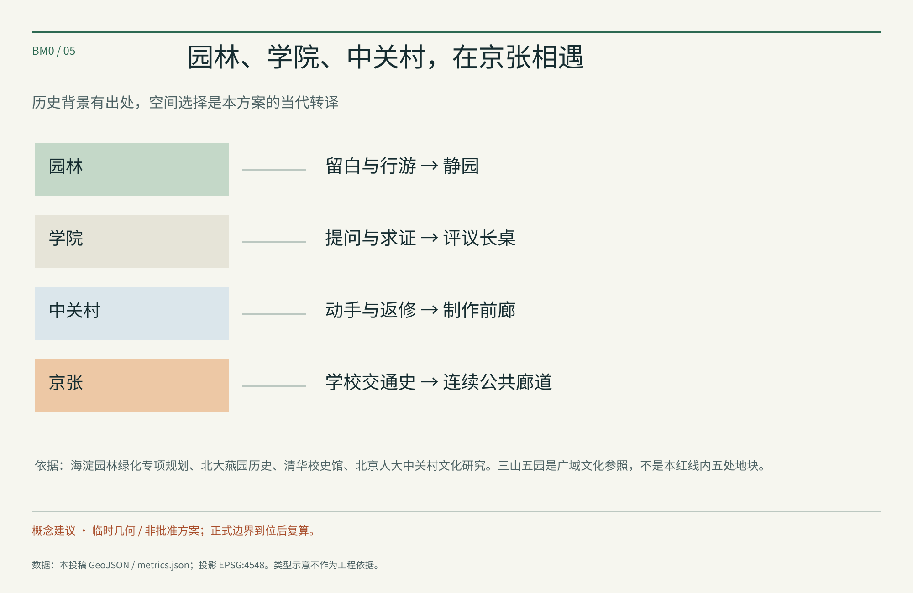

### 地标体系：沿京张展开的五园星环

五园不是五栋同样的圆楼，而是五个从外部能够识别为圆形的空间整体。楼群、园林、街巷和开放园庭共同形成轮廓：问道环院以六段弧形楼上扬，开物环厂以分离工场构成扇叶，共作圆街把可独立使用的小楼接成圆形街区，世界合院以三段建筑合抱；观生园环主要由植被、地形与路径构成，本轮模型不在这里新增建筑。圆形是当代创作，不声称历史五园原本都是圆形，也不复制皇家建筑 [source:HD-GARDEN-PLAN]。

全线按北向上的南北带状关系展开。官方任务指定众智园—北京AI原点—大钟寺自北向南，五园以三个主地标和两个中间园回应这条骨架，不把它们挤进一个紧凑新建园区。远景识别来自分段弧体的高低轮廓与园庭留白；近处则应看得出入口、工作台、书廊和公共穿行，而不只在无人机俯视时才成圆 [source:OFFICIAL-ANNOUNCEMENT] [metric:benchmark_node_count]。

| 五园 | 概念公共锚点 | 本轮空间组织 | 日常与海淀的关系 |
| --- | --- | --- | --- |
| 开物环厂 | 众智园 PUB-ZZY | 8段工场围绕工作庭；装卸与危险工序不经过公众前廊 | 中关村研究、工程与返修相接：借零件、做原型、受控验证 |
| 观生园环 | PUB-N3 | 景观主导；本轮不新增建筑，保护核查后的树木和生境 | 将三山五园的行游、留白转成无需消费的日常游园与观察 |
| 问道环院 | AI原点 PUB-BM0 | 6段独立弧楼围合读书园庭；全高缺口维持穿行 | 学院提问、讨论与独处相邻，连接本地知识网络与公共评议 |
| 共作圆街 | PUB-N2 | 8段小型工作楼形成开口圆街，不设封闭园区门禁 | 开源共作、社区修理与短驻接待共用可分租单元 |
| 世界合院 | 大钟寺 PUB-DZS | 3段弧体形成抵达庭；首层展示与人工接待并置 | 京张组织抵达与交流；大钟寺仅为辅助文化层，不操作古钟 |

本轮将四个建筑型组团的分段基底放入临时模型的东侧非绿地功能单元，观生保留为景观节点，原有四个概念街区填充功能保留、基底重新布置。由此形成29个建筑基底要素；它们不是29座实测建筑或批准项目。五园仍为五个空间整体，三个主地标仍为三个，三个计数口径不能混用。圆形基底是可复算的概念落位情景，尚未选择实际可用地块，不赋予拆迁、用地或建设许可 [data:geometry/buildings.geojson] [metric:building_count] [metric:landmark_count]。

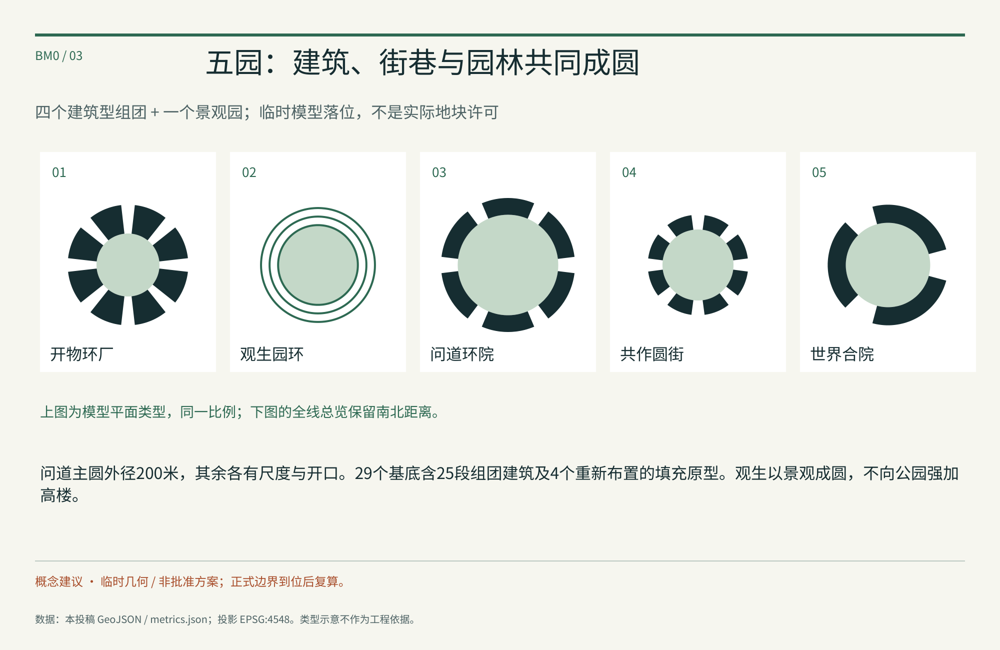

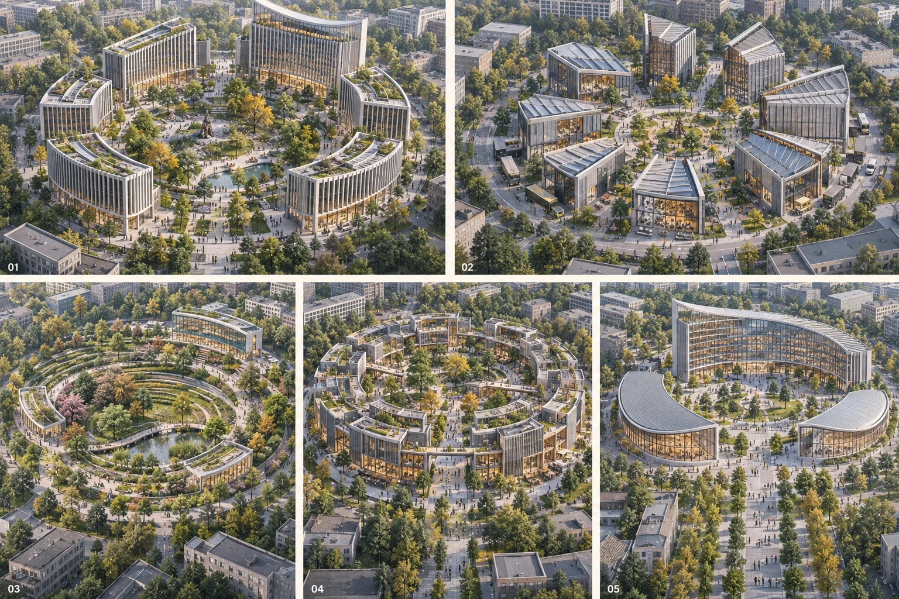

图中编号为类型序号：01问道、02开物、03观生、04共作、05世界，不是南北排列。03是前一轮带低层配套的景观类型比较；本轮选择仅保留景观与路径，不将图中的配套楼纳入新建模型。其他图的建筑数量和高度也不能作为工程读数。最新平面和计数以上方模型平面图及几何文件为准。

家族图仅比较建筑与景观类型，不表示五园现实中彼此相邻。图中建筑数量、楼层与退台不作为测量依据；正式面积从GeoJSON复算。主组团地面图研究“读书—制作—穿行”的邻接，不表示已经获得居民同意或无障碍验收。高风险试验必须进入独立受控场，公众路线和不使用设备的路线始终保留在试验边界外 [depth:three_key_area_detailed_design]。

### 三山如何连接五园

“三山”是三段有不同日常内容的公共联系，不是三座绵延数公里的建筑。北段读山串起开物—观生—问道，中段作山连接问道—共作，南段会山连接共作—世界；三段共享节点，形成五节点、四连接的连续网络。沿京张的平层公共路径承担基本通行，局部种植坡地、书廊、工作前廊、可进入屋顶和短跨连接提供起伏的山形体验，任何一段局部设施关闭都不应切断地面路线 [data:geometry/roads.geojson#ROAD-TRUNK] [depth:blue_green_public_space]。

| 山廊 | 连接与功能 | 形态与使用边界 |
| --- | --- | --- |
| 读山 / 北段 | 开物—观生—问道；从制作进入自然观察和公开讨论 | 地面园路为主，局部地景缓坡与阅读廊；安静区域不设扩音活动 |
| 作山 / 中段 | 问道—共作；把讨论变成可测试、可返修的作品 | 局部可使用的坡顶工坊与雨棚，公共步行、设备运送和测试区分开 |
| 会山 / 南段 | 共作—世界；展示、交流、维护交接 | 地面发布步道、局部论坛屋顶与遮雨廊；日常穿行不经过售票或活动安检区 |

临时节点中心直线分段约为3.11、2.43、1.94公里，说明它们是城市尺度联系而非连廊跨度；不是实测道路长度。道路、轨道、遗产、河道和现状项目的每处交会须分别查证。不能默认跨越在用铁路、抬高全部公共地面，或因坡顶路径不足而依赖电梯维持唯一无障碍通行。屋顶、扶手、排水、积雪、风环境、消防和结构均待专业复核；试验设备停用不影响普通通行 [depth:traffic_rail_slow_parking] [depth:risk_missing_data]。

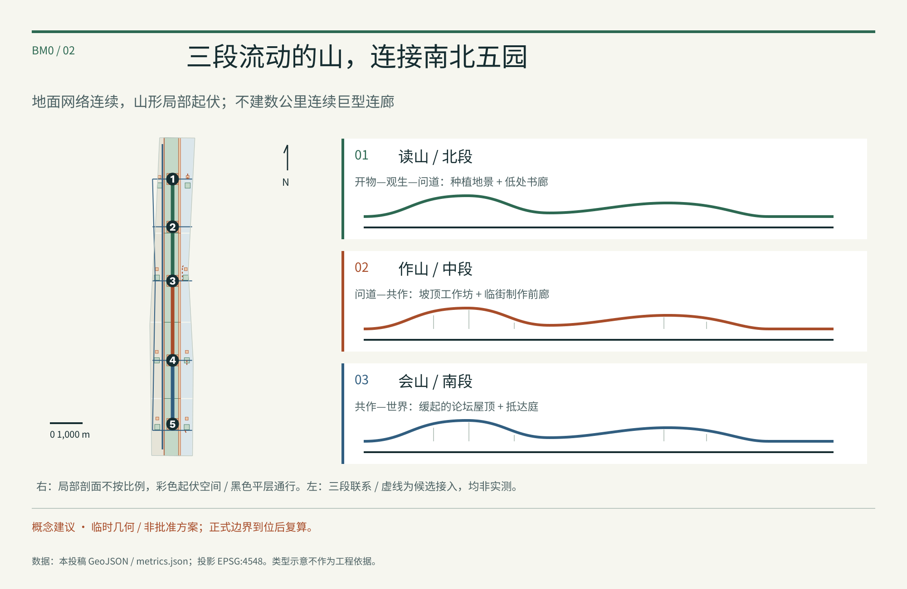

模型还为五园分别计算了从现有概念路网进入圆形开口的候选步行接入线，保存在 `visual/assets/ensemble-model.json`，与建筑基底无穿越冲突。接入线是待核验情景，不计入原有道路长度指标；树木、坡度、权属和实际路口条件未据此取得许可。建筑避让模型道路中心线所用12米仅为排除明显碰撞的假设，不是法定退界。

### 限高：用足适用条件，不把最高数字套遍全线

已找到部分公开控制文件，因此不再笼统写“高度控制尚未发布”。但五园还没有与真实地块、权属和全部适用限制一一对应，法定高度、容积率和确认可建规模仍待资料补齐。京张沿线街区控规公开版第8页列有36/45/60/80/100米基准分区，第9页要求保护景观视廊并形成多层次空间；其北界为成府路，不覆盖北至北五环的全部征集范围，100米不能当作五园通用上限 [source:HD-HEIGHT-BLOCK-2026]。

学院路北端A/B/C/J条件第1页表格列80米，但第2页进一步区分A中央不高于60米、B/J约70米等，不能只读表格。蓝景丽家供地条件第2页分别列60米与24米，第3页另有限制及连廊计容要求；已有项目也不属于可任意重画的空地。应逐地块叠合高度、视廊、日照、退界、树木、轨道与在建项目，再研究接近该位置适用上限的高点 [source:HD-HEIGHT-XUEYUAN-2018] [source:HD-HEIGHT-LANJING-2025] [source:HD-LANJING-PROGRESS-2026]。

问道类型研究用200米外径、150米内园和六个全高缺口比较60/80米包络，数字仅为设计假设。它用于检验“是否需要整圈同高”等问题，不用于证明具体地块可以承载。其他四园不强行同高；观生不靠高楼成为地标。若落位承载力不足，应缩径、减少体量或改造嵌入，而不是保持效果图规模后隐藏冲突 [depth:height_massing_character] [depth:development_intensity_controls]。

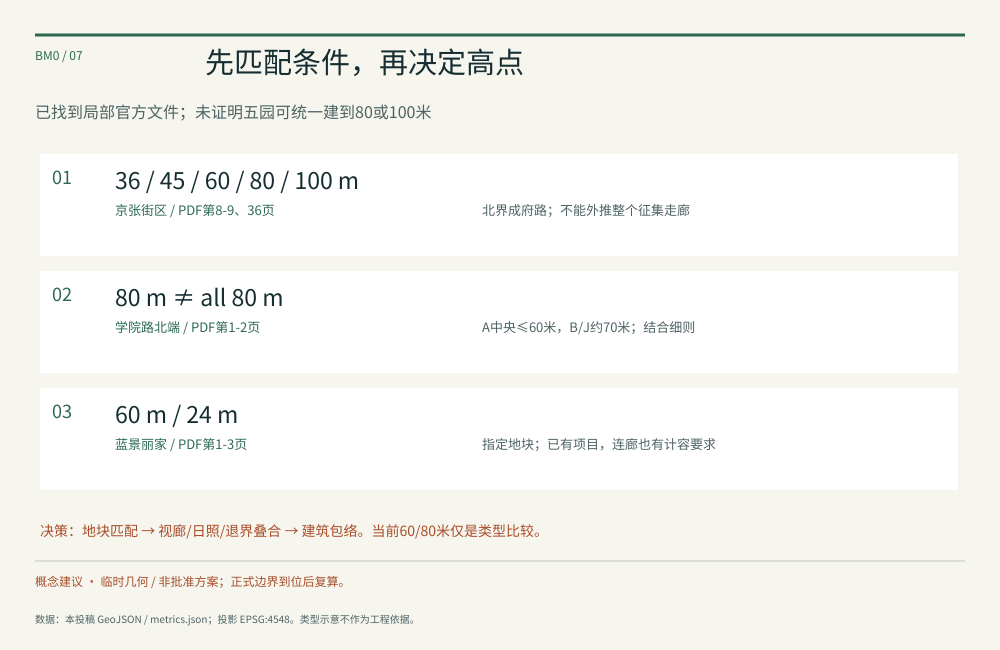


### 一份能兑现的邀请：带着问题来，留下作品

以下是可供运营团队深化的试点制度，不是已开放的服务。首批采用64天为一轮的驻留节奏：第1—7天理解海淀真实问题与权益边界，第8—28天制作，第29—49天在授权场内复核，第50—64天公开演示并交接维护。64天只是组织节奏，不能代替安全或长期有效性验证 [depth:phasing_implementation]。

| 来访者需要什么 | 试点提供什么 | 谁负责与如何检验 |
| --- | --- | --- |
| 可以开始，不先证明自己有名 | 公开问题清单、基础工位、低风险工具培训；部分名额供无机构背景申请者 | 拟议运营主体公布名额、遴选理由与申诉路径，不许诺免费住房或签证 |
| 找到能一起做事的人 | 本地问题提出者、研究者、工程师与国际维护者组成小组 | 合作名单须逐一取得同意，不能预列高校或企业为已签约伙伴 |
| 有时间失败并重来 | 每周返修桌、每月复现日；失败过程也可展示 | 开源与公开范围由贡献者事先选择，敏感代码或个人数据不公开 |
| 不只来一次大会 | 完成作品需指定90天维护联系人；后续年度邀请基于维护记录 | 看问题解决、可复现率、持续维护、居民反馈，不以打卡或招商人次替代 |

日常节奏比节庆更重要：上午读书与问答、下午制作和维修、傍晚小规模展示；冬季把工作移到合法可用的室内首层，夏季使用树荫和通风庭院。静园不随活动扩音，夜间智能照明故障时回到安全基础照明。居民不报名、不扫码、不参与测试，也能完整使用公共空间 [standard:PROJECT-AGENT-OPEN-CALL-TASKBOOK]。

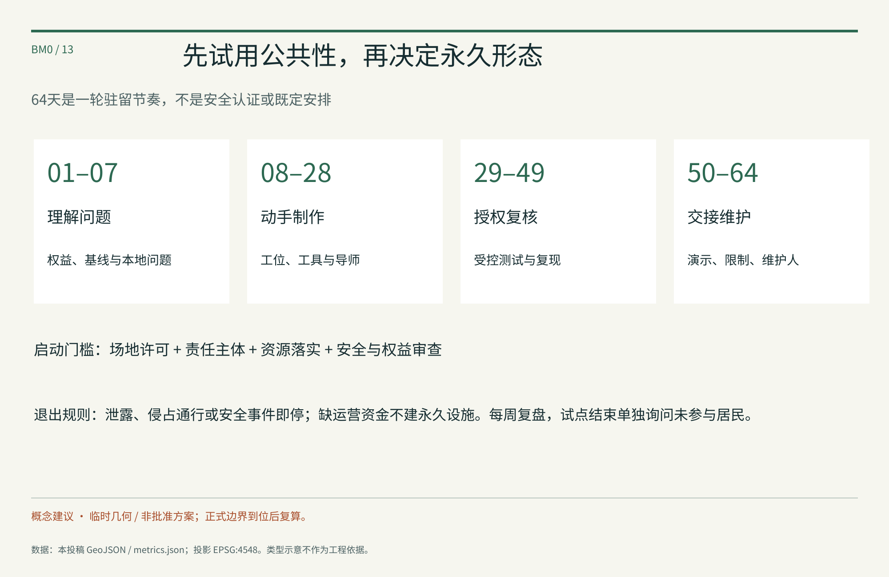

### 把经典作为长期检验，而不是自我认证

先验证公共性再决定永久形态。首轮拟通过既有合法场所内的可移动长桌与制作工位试用，资金到账、运营责任、文保与安全许可缺一则不启动。每周公布使用时段、维护停机、噪声投诉处理和公众通行是否被影响；试点结束让参与者与非参与居民分别评价。若项目只能靠持续封场、大屏宣传或强制数据采集维持，则应撤掉试验设施，保留普通公园功能 [depth:renewal_project_list]。

永久公共骨架、可拆换技术构件与短周期软件分层维护；品牌不依附单一模型或供应商。能在没有发布会、没有屏幕、没有最新设备时仍值得停留，才有成为经典的条件。这是设计目标，不是已获证明的效果。

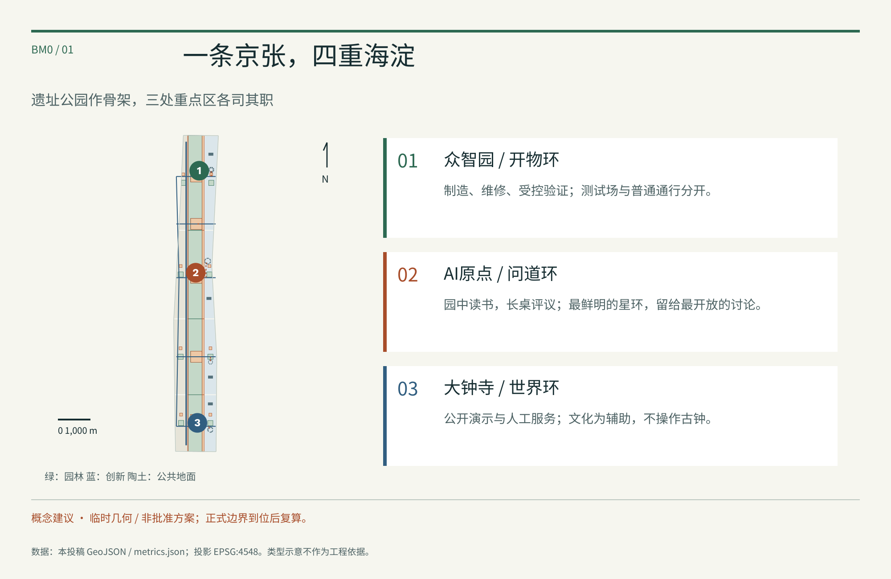

## 设计依据与资料清单

本方案以北京市规划和自然资源委员会海淀分局《百年京张AI创新带城市设计国际方案征集资格预审公告》为第一依据，以 `brief/site-package/` 的任务书、枚举、规划限值与来源登记为机器可读依据 [source:OFFICIAL-ANNOUNCEMENT] [source:AGENT-TASKBOOK]。方案把事实、设计建议与待专业确认事项分开：可核验事实写证据、设计判断写意图、缺口写“待正式数据补齐”，不用貌似精确的参数制造确定性。

组织方尚未发布官方精确 polygon，本方案使用仓库明确标记的临时粗略边界 `SITE-001` 与三处重点区，全部标注为 `provisional_constraint`、`official_boundary=false` [source:BOUNDARY-SOURCE] [data:geometry/site_boundary.geojson#SITE-001]。它们只用于概念生成、空间复核与自检，不是官方红线、审批依据或精确面积依据；官方几何到位后，九类图层、全部指标、图件与 PDF 必须从边界开始整体复算 [depth:risk_missing_data]。该组织方数据缺口本身不阻断内容评分。

临时模型是南北向狭长走廊，宽约1.4公里、长约9.7公里，宽长比约0.14。这些数值描述提交模型，不是实测红线。线性条件使南北连续与东西缝合同时重要，但不证明Y形只能在此成立 [metric:corridor_width_m] [metric:corridor_length_m] [metric:corridor_linearity_ratio]。


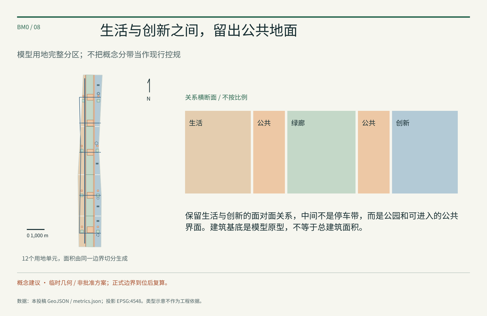
## 三层范围工作框架

统筹研究范围回答“海淀如何把科研、产业、公共服务与全球协作组织成可持续的校准体系”；总体设计范围回答“约 11.41 平方公里的走廊如何用一条可进入的绿轴 + 一组可调用的校准节点形成连续系统”；三处重点区域回答“一个校准场在具体场所里怎样制造、评议、首用并退出” [depth:three_level_scope_framework]。三层不是三个互不相干的圈，而是同一条 Y 形的三个尺度 [depth:overall_spatial_structure]。

**Y形仅是工作往返的概念关系图，不是现场轨道或地块形状。** 青龙桥工程启发“试验后返回修订”的方法；总体空间以提交几何中的南北绿轴与东西缝合为准。以下示意不按地理比例，不把“三区两翼”简化为实际三条铁路：

```
          众智园 ●  (Y 形北端 · 制造与验证 / Leg A)
                   ╲
                    ╲  定标线：把成果带回原点评议
                     ╲
  中关村科技服务翼 ────●──── 分岔点 BM0：AI 原点社区（提问与校准标准制定）
  （要素全球化配置）      ╱
                        ╱  折返线：带着校准结果南下
                       ╱
          大钟寺 ●  (Y 形南端 · 发布与首用 / Leg B)
```

北京AI原点社区负责提问和评议，众智园负责制造与验证，大钟寺负责公开展示与首用；各节点之间允许多次往返。这里的“折返”指作品接受反馈后返回修订，不是对历史列车运行过程的复演 [data:geometry/key_areas.geojson#PROV-KEY-002]。

任务书中的三大定位、五大功能与三区两翼不是并列口号，而是由同一条 Y 形连接的闭环。下表逐项对应（这是评审要求的“定位—功能—三区两翼”总表）[source:AGENT-TASKBOOK] [standard:PROJECT-AGENT-OPEN-CALL-TASKBOOK]：

| 层级 | 任务书要求 | BM0 空间—运营响应 | 可检查输出 |
| --- | --- | --- | --- |
| 定位 | 百年京张文化带 | 中轴绿轴 = 京张遗址公园校准绿轴，BM 里程标以枕木节奏记录 | 遗产叙事、开放档案、全年公共生活 [data:geometry/green_space.geojson#GREEN-C-S3] |
| 定位 | 都市AI生活体验带 | 中轴硬质公共带 + 侧带社区广场，居民可进入、可选择、可退出 | 日常 AI 体验、无 AI 基线路径 [data:geometry/public_space.geojson#PUB-EDGE-S2W] |
| 定位 | AI融合创新带 | Y 形三端：提问（原点）→ 制造（众智园）→ 首发（大钟寺） | 从世界问题到开放原型再到城市首发 [metric:benchmark_node_count] |
| 功能 | AI全栈自主创新体系 | 众智园校准庭：模型、芯片、硬件、具身系统的基准测试场 | 全栈验证场景、开放评测 [metric:industry_validation_scenario_count] |
| 功能 | 世界级AI创新生态 | 原点社区开放评议：开源协作、全球会客、青年生活 | 生态案例机制、开发者社区 [metric:ecosystem_case_count] |
| 功能 | AI+场景赋能新范式 | 小月河场景赋能翼 + 中轴真实生活场景 | 公开问题征集、真实环境反馈 [data:geometry/roads.geojson#ROAD-LOOP] |
| 功能 | 智能化AI活力城市 | 大钟寺首发庭：AI 原生市集、文化展演、全球首发周 | 智能原生新业态、全年活动节律 [data:geometry/buildings.geojson#BLDG-DZS-A] |
| 功能 | AI治理全球话语权 | 全线公开维护日志：谁测的、怎么测的、结果是否可复核 | 人工最终权限、停止条件、记录公开 [standard:GENERATIVE-AI-INTERIM-MEASURES] |
| 三区 | 北京AI原点社区 | Y 形分岔点 BM0：提问与校准标准制定 | 世界级AI创新生态  |
| 三区 | 众智园AI自主创新加速区 | Leg A：制造与验证 | 全栈自主创新与 AI 治理  |
| 三区 | 大钟寺AI产业集聚区 | Leg B：发布与首用 | 智能原生新业态  |
| 两翼 | 中关村科技服务翼 | 外轨：人才、资本、算力、数据与专业服务 uplink | 要素配置、中关村 IP 与资本赋能 |
| 两翼 | 小月河场景赋能翼 | 内轨：居民、学生、访客与真实生活场景 downlink | 场景赋能与智能化 AI 活力城市 |

### 区域协同总表（概念建议，非既定协议）

任务书明确要求体现与北纬社区、未来科学城、怀柔科学城、经开区及京津冀的协同。以下只定义**可进一步洽谈的公共接口**，不虚构任何协议、路线、采购、投资或既定政策；每条关系的交换对象、方向与触发条件均为概念建议，供专业团队与对应主体深化 [source:AGENT-TASKBOOK] [depth:three_level_scope_framework]：

| 协同对象 | 交换对象 | 方向 | 触发条件 | 证据状态 |
| --- | --- | --- | --- | --- |
| 北纬社区（北下关） | 高校院所知识、青年居住、城市更新经验 | 北纬社区 → 原点社区：人才与场景；原点社区 → 北纬社区：开放评议与活动 | 北纬社区更新项目进入概念深化阶段时 | 公开背景资料，未形成协议 [source:SOURCE-REGISTRY] |
| 未来科学城 | 大科学装置、能源与材料前沿、超大算力 | 未来科学城 → 众智园：硬科技供应；众智园 → 未来科学城：AI 场景与验证需求 | 双方发布面向 AI 的协同开放课题时 | 公开背景资料，未形成协议 |
| 怀柔科学城 | 基础科学、国家实验室、原始创新 | 怀柔科学城 → 原点社区：源头问题；原点社区 → 怀柔科学城：开放评测与基准需求 | 任一公共基准议题立项时 | 公开背景资料，未形成协议 |
| 北京经开区 | 智能制造、整车与机器人量产、场景运营 | 经开区 → 大钟寺：量产能力与供应链；大钟寺 → 经开区：AI 原生新业态与首发需求 | 具身智能安全场从试点进入量产验证时 | 公开背景资料，未形成协议 |
| 京津冀 | 城市群场景、数据流通试验、产业梯度 | 京津冀城市群 → 一带：真实场景与数据；一带 → 城市群：校准标准与公共日志 | 区域数据流通试点或场景开放清单发布时 | 公开背景资料，未形成协议 |

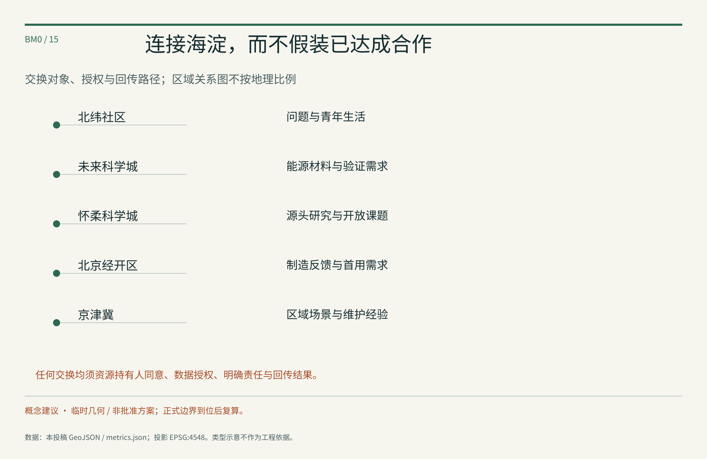

## 统筹研究范围产业与未来城市研究

产业定位不是“再建一个 AI 园区”，而是把海淀已有的高校院所、开源维护者、企业与公共服务运营者接入**一套公共校准制度** [depth:overall_spatial_structure]。五步工程方法链在这里直接变成产业逻辑：

- **勘测**：以公开问题征集为“测量”，摸清真实城市里 AI 还做不好什么；
- **定标**：在 BM0 原点把“做得好”的定义公开化、可复核化——这就是 benchmark；
- **分岔**：按“制造—评议—首用”分流到众智园、原点社区、大钟寺三条支线；
- **试验**：在三处校准场与真实环境中试运行，人工保留最终权限；
- **维护**：公开维护日志沉淀为公共知识资产，允许失败被看见、被复盘、被改进。

七个全球案例只提取**可审查的机制**，不复制任何案例的形态、品牌或图像 [source:AGENT-TASKBOOK] [metric:ecosystem_case_count]：

| 案例 | 可转译机制 | BM0 的落位 | 明确不复制 |
| --- | --- | --- | --- |
| Mila（蒙特利尔） | 开放科学与伦理共同体 | 原点社区开放评议庭 | 组织架构与品牌 |
| Kendall Square（剑桥） | 高频公共活动带动知识扩散 | 中轴公共带全年活动节律 | 街区形态与密度 |
| Station F（巴黎） | 分期驻留与全球软着陆 | 国际访问者软着陆端口 | 单体建筑与运营主体 |
| Knowledge Quarter（伦敦） | 跨机构治理与公共知识 | 一带公共基准治理委员会 | 治理章程文本 |
| one-north（新加坡） | 孵化器与社区营造耦合 | 众智园试验簇 + 青年生活 | 建筑与景观语言 |
| Seoul AI Hub（首尔） | 分阶段支持与成果转化 | 三区三期验证路径 | 政策补贴模式 |
| Ars Electronica（林茨） | 公共原型化与艺术—科技对话 | 大钟寺首发庭 + 声场 | 活动品牌与展览 |

## 总体设计范围城市更新与控规深度城市设计

总体设计范围以中轴绿轴为骨架，横向上分五条带 [data:geometry/land_use.geojson] [depth:land_use_layout]：

| 带 | 宽度占比 | 主要功能 | 用地代码 | BM0 角色 |
| --- | --- | --- | --- | --- |
| 西侧生活带 | 31% | 居住、社区服务、教育 | 0701/0702/0804 | 日常城市生活界面 [data:geometry/land_use.geojson#LU-WS2] |
| 中轴公共西带 | 1.5% | 硬质公共活动 | 1403 | 校准绿轴的公共边缘 [data:geometry/public_space.geojson#PUB-EDGE-S2W] |
| 中轴绿廊 | 31.2% | 公园绿地 | 1401 | Y 形主干，BM 里程标路径 [data:geometry/green_space.geojson#GREEN-C-S3] |
| 中轴公共东带 | 4.6% | 硬质公共活动 | 1403 | 校准绿轴的公共边缘 [data:geometry/public_space.geojson#PUB-EDGE-S2E] |
| 东侧创新带 | 31.7% | 科研、商业、商务 | 0802/0901/0902 | 创新、验证与发布功能界面 |

用地分区由同一临时边界切分生成，完整覆盖、无空隙无重叠，相邻多边形共享切分线坐标 [metric:land_use_cell_count]；绿地与公共空间在几何构造上互斥（公共空间从绿地中做差集），绿地率与公共空间率不会重复计算 [metric:green_public_disjoint]。建筑以概念原型表达，不构成批准建筑、拆改留结论或红线 [depth:height_massing_character] [depth:retain_renovate_demolish]。容积率、建筑高度与总建筑规模维持 待正式数据补齐，因为五园尚未与真实地块和全部适用条件逐项匹配；部分公开控制已补充在高度章节，不能外推全线 [depth:development_intensity_controls] [metric:floor_area_ratio]。


## 重点区域详细设计

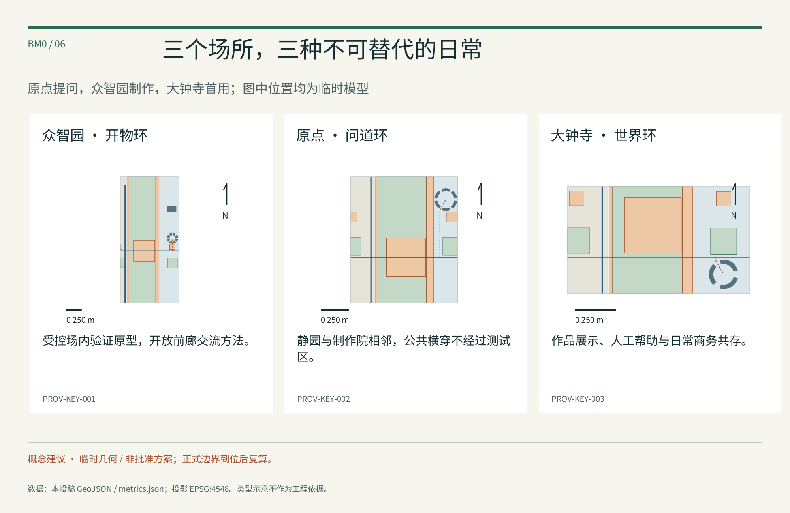

三处重点区域对应 Y 形的三端，每处回答“一个校准场在具体场所里怎么运转” [depth:three_key_area_detailed_design] [data:geometry/key_areas.geojson]：

**众智园AI自主创新加速区（Leg A · 制造与验证）** [data:geometry/key_areas.geojson#PROV-KEY-001]
校准庭是具身智能与硬件的真实环境基准测试场：模型、芯片、机械臂、低速机器人与自动驾驶接驳在这里面对真实天气、真实人流与真实故障。每台被测系统配置“普通人工基线、最小数据边界、责任角色、停止条件、64 天复核与退出路径”六要素 [metric:industry_validation_scenario_count]。测试区在运行时须独立受控；非测试时段，经安全恢复检查后可回归普通公共空间。

**北京AI原点社区（Y 形分岔点 BM0 · 提问与校准标准制定）** [data:geometry/key_areas.geojson#PROV-KEY-002]
BM0 原点广场是校准标准的诞生地：公开问题榜、开放评测、红队评议、开源协作都从这里发起。这里立着零号水准点纪念碑——一个拟议可触摸、可合影的原创公共标记，不是既有测绘基准点或已批准纪念物。校准标准不是专家闭门制定的，而是在这个广场上被公开提问、被居民评议、被逐版修订的。广场无门票、可穿越、非活动日照常可用 [metric:landmark_count]。

**大钟寺AI产业集聚区（Leg B · 发布与首用）** [data:geometry/key_areas.geojson#PROV-KEY-003]
首发庭提出作品展示、人工服务和小规模市集的组合。大钟寺作为辅助文化层，可研究低干扰、可关闭的室内声音解释，具体内容及素材须清权；不操作古钟，不以扩音宣告结果，不假设已获文保或活动许可。作品仍须公开方法、限制和维护安排。

## AI 创新生态、人才画像与 AI+ 场景

### 校准协议：所有场景共同遵循的最小契约

每个 AI 场景必须通过“校准协议”七问才能上线：①服务对象是谁；②使用哪些最小数据；③普通人工基线是什么（无 AI 时如何完成）；④责任人是谁；⑤停止条件是什么；⑥是否在 64 天内复核；⑦退出路径在哪 [standard:GENERATIVE-AI-INTERIM-MEASURES] [standard:BARRIER-FREE-ENVIRONMENT-LAW] [depth:ai_scenarios_governance]。七问缺一不可，答案公开可查。

### 12 张 AI 场景卡（每卡：对象—地点—数据—人工复核—退出—运营—指标）

| 卡号 | 场景 | 服务对象 | 地点 | 最小数据 | 人工复核 | 退出条件 | 运营方 | 指标 |
| --- | --- | --- | --- | --- | --- | --- | --- | --- |
| SC-01 | 无障碍通行校准 | 轮椅与视障使用者 | 中轴公共带 [data:geometry/public_space.geojson#PUB-EDGE-S2W] | 现场障碍物识别，不留存影像 | 无 AI 基线对照 + 使用者评议 | 连续 3 次错误即停用 | 公共服务运营者 | 通行成功率 |
| SC-02 | 具身机器人安全场 | 机器人企业与市民 | 众智园校准庭 [data:geometry/public_space.geojson#PUB-ZZY] | 测试场地内传感器数据 | 人工急停 + 围界安全员 | 制动距离超阈即停 | 众智园运营主体 | 制动距离/避障率 |
| SC-03 | 开放模型公共评测 | 模型开发者 | 原点社区评议庭 | 公开问题榜，不含私人数据 | 结果公布前人工复核 | 评测方法不透明即停 | 原点社区理事会 | 公开评测轮次 |
| SC-04 | 低速接驳自动驾驶 | 通勤学生与居民 | 中轴绿道 [data:geometry/roads.geojson#ROAD-TRUNK] | 接驳路线定位，不留存人脸 | 安全员随车至验收通过 | 任意事故即停 | 轨道接驳运营方 | 准点率/事故数 |
| SC-05 | 老年助老服务 | 独居与行动不便长者 | 西侧生活带社区中心 [data:geometry/land_use.geojson#LU-WS3] | 只记录服务请求类型 | 不越界作医疗判断 | 长者不适即转人工 | 社区服务中心 | 服务响应时长 |
| SC-06 | AI 法律咨询导航 | 居民与新创企业 | 东侧创新带服务厅 | 仅咨询主题类别 | 结论需执业者复核 | 涉及诉讼即转人工 | 公共法律服务中心 | 转人工率 |
| SC-07 | 青少年 AI 教育工坊 | 中小学生与家庭 | 中轴公共带 + 教育用地 [data:geometry/land_use.geojson#LU-WS4] | 作品数据匿名化 | 教师全程在场 | 出圈内容即下架 | 教育部门 | 工坊覆盖人数 |
| SC-08 | 开源维护者驻留 | 全球开源开发者 | 原点社区开放评议庭 | 项目公开数据 | 维护者自治 | 社区表决退出 | 开发者社区 | 驻留批次 |
| SC-09 | 城市问题公开征集 | 全体市民 | BM0 原点广场 | 建议文本，去标识化 | 理事会人工审议 | 恶意内容即剔除 | 原点社区理事会 | 建议采纳率 |
| SC-10 | 夜间活力与步行安全 | 夜间活动市民 | 中轴公共带南段 | 仅统计人流，不识别个体 | 人工值守复核 | 异常即停智能控制，保持安全基础照明 | 拟议街道与养护协作方 | 故障转人工时长 |
| SC-11 | 公共空间无设备路径 | 全体市民 | 全线公共空间 | 无数据采集 | 天然人工 | 无需退出（默认无 AI） | 市政养护 | 无设备路径占比 |
| SC-12 | 国际访问者软着陆 | 国际创新者 | 大钟寺首发庭 [data:geometry/public_space.geojson#PUB-DZS] | 仅登记行业与停留目的 | 人工接待为主 | 隐私请求即删除 | 国际招商团队 | 软着陆转化数 |

### 3 个产业测试验证场景（首批）

| 验证场 | 验证什么 | 验收阈值（概念建议） | 停用阈值 |
| --- | --- | --- | --- |
| TV-1 无障碍人机共行测试场 | 轮椅/导盲设备在真实街道的可用性 | 连续 90 天无安全事件且使用者满意度 ≥80% | 任何一次安全事件 |
| TV-2 开放模型公共评测 | 模型在真实问题榜上的公开表现 | 评测方法透明 + 结果可复核 + 三模型以上参与 | 方法不透明或数据污染 |
| TV-3 具身智能安全场 | 低速机器人与人的共存安全 | 制动与避障达标 + 人工急停 100% 可用 | 制动距离超阈或急停失效 |

### 8 类用户画像

研究者/算法工程师、开源维护者、创业团队、国际访问创新者、居民与长者、儿童与照护者、无障碍使用者、公共服务运营者。前四类是"来做酷事的人"，后四类是"把这里当家的日常人" [metric:persona_count]——校准协议的第一条原则是：**日常人不被当作数据原料，也不被测试占用**；经安全恢复检查后，可恢复的测试空间在非活动时段回归公共使用；隔离设备区不向公众开放。

### AI 创新生态图谱八要素

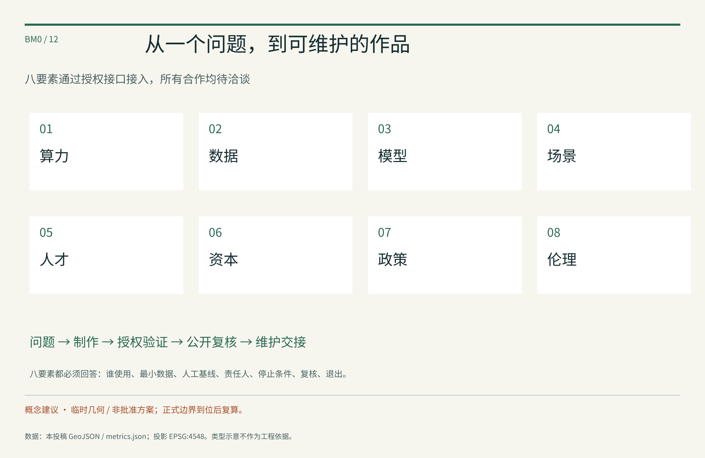

八要素不是并列的资源清单，而是以 BM0 校准原点为中心的协同网络。算力与数据构成底层基础设施，模型与场景是校准的对象与场地，人才与资本是流动的生产要素，政策与伦理是不可妥协的边界条件。八要素在 BM0 中的落位遵循校准协议：任何要素的接入都必须回答七问，任何要素的退出都有明确路径 [metric:ecosystem_pillar_count]。

| 要素 | BM0 接口 | 校准协议约束 |
| --- | --- | --- |
| 算力 | 众智园边缘算力池 + 云端异构调度 | 测试算力隔离，非活动时段释放 |
| 数据 | 城市真实场景数据，去标识化流通 | 最小数据原则，不留存生物识别信息 |
| 模型 | 原点社区公开评测榜 | 评测方法透明，三模型以上参与 |
| 场景 | 12 张场景卡 + 3 个验证场 | 人工最终权限，停止条件明确 |
| 人才 | 开源驻留 + 国际软着陆 + 本地运营 | 社区自治，表决退出 |
| 资本 | 公共财政 + 社会资本 + 算力捐赠 | 不承诺只进不退，验收阈值公开 |
| 政策 | 一带公共基准治理委员会 | 不虚构既定协议，只定义可洽谈接口 |
| 伦理 | 人工最终权限 + 停止条件 + 退出路径 | 任何场景默认保留无 AI 基线路径 |

## 用地、建筑规模与拆改留方案

用地分区完整覆盖临时边界，绿地率 33.1%、公共空间率 12.9%，两者均从提交几何在 EPSG:4548 下复算（组织方尚未发布官方 polygon；正式数据到位后须整体重算）；这一高公共性**有概念支撑**：BM0 的核心是在真实城市环境校准 AI，必须把最大面积留给真实可进入的公共空间 [metric:green_ratio] [metric:public_space_ratio]。建筑模型已更新为29个独立基底，表达四个建筑型圆形组团与四个街区填充单元；第五园为景观主导。建筑基底合计约9.33万平方米，仅为本轮概念情景，不是现有城区总建筑基底。两个旧填充原型曾与模型绿地相交，本轮保留其功能、重排四个填充基底并做叠合排查 [metric:building_footprint_area_sqm] [metric:building_count]。拆改留不做地块级结论：本方案只对**空间策略**提概念建议（如中轴沿线公共化、首层开放），具体保留、改造、拆除与新建必须以专业文保、权属与工程调查为准 [depth:retain_renovate_demolish]。**说明**：未与同类方案做横向比较，亦未声明高于任何场外中位水平。

## 交通、轨道、市政与公共服务设施

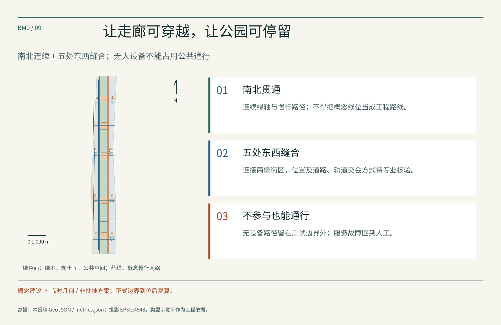

交通策略以“缝合”为第一原则：走廊不是割裂东西的墙，而是接续两边的轴。五条东西缝合通道跨越中轴，全部做无障碍接续 [data:geometry/roads.geojson#ROAD-X1] [depth:traffic_rail_slow_parking]；南北以校准绿道为慢行主轴，低速接驳串联轨道站点与三处校准场 [data:geometry/roads.geojson#ROAD-TRUNK]。市政与新型基础设施按“先制度、后硬件”提出概念方向：供能与数据网络支持临时供能隔离，为可逆试点服务 [depth:municipal_new_infrastructure]。轨道、市政管线、能源负荷等专业测算不属于本概念方案范畴，保持“待专业深化”。

## 蓝绿空间、公共空间与城市风貌

中轴绿廊是一条贯穿南北的连续公园，是 Y 形主干，也是 BM 里程标的载体：以枕木节奏设置 64 组概念里程标，记录"这里校准过什么、谁校准的、结果如何" [metric:milestone_marker_count]。公共空间体系分三级：BM 节点（原点广场、众智园校准庭、大钟寺首发庭 + 两个里程广场）[metric:benchmark_node_count]、中轴公共带、街区社区广场 [data:geometry/public_space.geojson]。风貌语言取京张工程美学：轨道、道岔、枕木、里程标、水准点，而不是玻璃幕墙与霓虹；以技术可替换、公共空间可长期维护为设计目标 [depth:blue_green_public_space] [metric:landmark_count]。

### 公共空间组件库

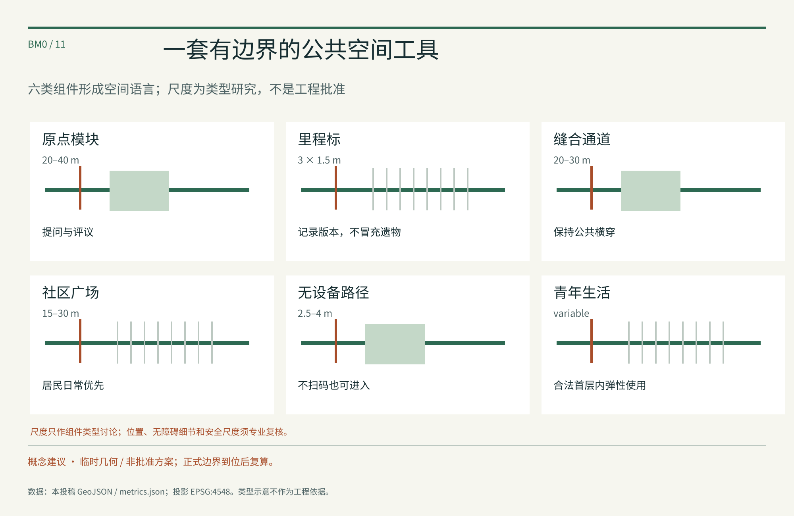

BM0 的公共空间不是一次性设计的固定场所，而是一套可组合、可替换、可扩展的模块化组件系统。六个模块对应 Y 形三端与两翼的不同尺度需求，每个模块都有明确的尺寸区间、适用场景与组合逻辑 [depth:public_space_component_kit] [metric:public_space_module_count]：

| 模块 | 尺度 | 适用场景 | 组合逻辑 |
| --- | --- | --- | --- |
| BM 原点模块 | 20–40 m 直径 | 原点广场、校准庭、首发庭 | 三区概念锚点，位置须经专业校核 |
| 里程标模块 | 3 × 1.5 m | 中轴绿廊沿线 | 间距待现场校核，枕木节奏，可增减 |
| 缝合通道模块 | 宽 20–30 m | 东西向跨越中轴 | 5条概念关系，位置与宽度待专业校核 |
| 社区广场模块 | 15–30 m 边长 | 西侧生活带街区 | 嵌入式，数量可扩展 |
| 无设备路径 | 宽 2.5–4 m | 全线公共空间 | 默认存在，宽度随场地调整 |
| 青年生活模块 | 混合尺度 | 东侧创新带底层 | 与建筑首层耦合，功能可置换 |

组件库的设计原则是：技术可替换、公共空间可长期维护。任何一个模块的替换都不应动摇 Y 形结构与校准协议的整体框架。


## 更新项目清单、实施政策与分期计划

### 项目包（每项含责任角色、前置条件、资源接口、验收与停用阈值、阶段依赖）

| 项目包 | 责任角色（概念） | 前置条件 | 资源接口 | 验收阈值 | 停用阈值 | 阶段依赖 |
| --- | --- | --- | --- | --- | --- | --- |
| P1 BM0 原点广场与零号基准碑 | 原点社区理事会 + 专业团队 | 权属确认、文保评估 | 公共财政 + 社会资本 | 无障碍验收 + 公众评议通过 | 文保或安全否决 | 阶段一 |
| P2 校准协议与公开问题榜 | 原点社区理事会 + 开发者社区 | 试点授权 | 开放数据 + 志愿专家 | 三个真实问题上线并被响应 | 数据泄露 | 阶段一 |
| P3 具身智能安全场 | 众智园运营主体 + 安全员 | 安全评估、保险 | 园区 + 测试企业 | 急停 100% 可用 + 90 天无事故 | 任意安全事件 | 阶段一/二 |
| P4 开放模型公共评测 | 开源维护者 + 评议庭 | 评测方法公开 | 算力捐赠 + 志愿评测 | 三个以上模型参与 | 方法不透明 | 阶段一/二 |
| P5 五条东西缝合通道 | 街道办 + 市政专业团队 | 交通影响评估 | 区级更新资金 | 无障碍验收通过 | 安全否决 | 阶段二 |
| P6 中轴绿廊与 64 组里程标 | 园林部门 + 专业团队 | 遗址保护评估 | 公园专项 + 赞助 | 绿廊贯通 + 里程标双语上线 | 损害遗址 | 阶段二 |
| P7 大钟寺首发庭与声场 | 大钟寺运营主体 + 商务团队 | 业态规划、产权确认 | 社会资本 | 首发周试运营成功 | 扰民或安全事故 | 阶段三 |
| P8 国际软着陆端口 | 国际招商团队 + 运营主体 | 服务协议 | 驻留空间 + 法务 | 首个国际团队落地 | 服务违约 | 阶段三 |
| P9 公开维护日志与年度复盘 | 一带运营主体 + 审计 | 数据治理制度 | 公开平台 | 每年发布公开日志 | 记录失真 | 全程 |

### 分期与转化路径

- **阶段一 · 定标**（原点社区）：先立制度，后立地标。P1/P2 先行，把“校准标准公开化”这一制度成果先于任何硬件落地 [data:geometry/phasing.geojson#PHASE-1]。
- **阶段二 · 分岔与试验**（众智园 + 中轴）：P3–P6 把验证场与绿廊做成可逆试点，边试边修。
- **阶段三 · 维护与发布**（大钟寺 + 全线）：P7–P9 承载首发、软着陆与长期运营 [data:geometry/phasing.geojson#PHASE-3]。

转化路径是闭环的：访客 → 参与公开问题征集 → 进入驻留/评测 → 通过校准 → 首发 → 成为维护日志的一部分 → 吸引下一批访客 [depth:phasing_implementation] [depth:renewal_project_list]。任何试点设施都有明确的验收与停用阈值，没有“只进不退”的承诺。

## 指标体系、面积复算与合规矩阵

指标共 31 项：三个正式核心视觉指标（面积、绿地率、公共空间率）均为 `known` 且可从提交几何在 EPSG:4548 下复算，与 `visual/index.html` 展示值一致 [metric:site_area_sqm] [metric:green_ratio] [metric:public_space_ratio] （正式专业评分要求的三个核心视觉指标；组织方补全官方边界后须整体重算） [depth:metrics_recalculation]；容积率、建筑高度、总建筑规模、服务人口与客流预测维持 待正式数据补齐 并注明原因——这些依赖尚未逐地块匹配的适用控制、可用空间与调查数据 [metric:floor_area_ratio] [metric:population_served]。

场景卡 12 张、验证场景 3 个、用户画像 8 类、生态案例 7 个、朝圣地标 3 个、里程标 64 组、分期 3 期 [metric:phase_count] [metric:scenario_card_count] [metric:persona_count]。公告 1.3/1.4/1.5 与 `agent.1`–`agent.6` 全部在 `compliance_matrix.json` 中逐条映射；15 项正式设计深度全部 `complete`。


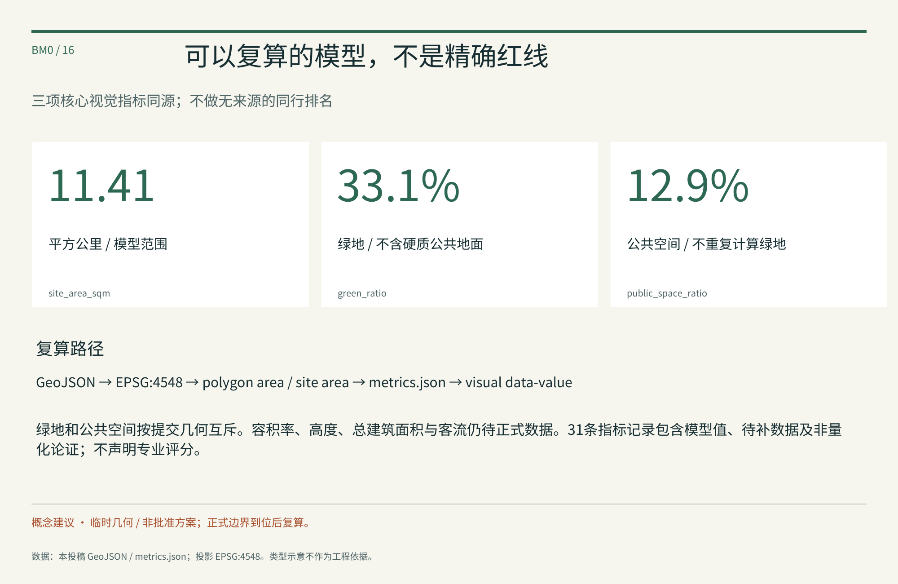
## 风险、版权与合规说明

本方案所有空间落地、活动运营、品牌传播与政策机制均为**概念建议、参考方案或可供专业团队深化研究**，不构成法定规划、政府审定、产权同意、投资承诺或工程可行性结论 [source:AGENT-TASKBOOK] [standard:PROJECT-OFFICIAL-ANNOUNCEMENT]。临时边界与低置信度指标已在本章与正文多处醒目标注，正式数据到位后必须整体复算 [depth:risk_missing_data]。AI 场景遵守校准协议：最小数据、人工复核、停止条件、退出路径；不做直接执法、诊断、福利资格决定或安全放行。字体、图像与生成媒体均登记来源与授权边界（见 `sources.json` 与 `report/copyright_statement.md`）；所有生成画面为解释层，不冒充现场照片、居民意见或官方数据。

**场地锚定是定性设计论证，不是独占权或量化得分。** 本轮用清华园站与学校交通史、燕园园林—校园叠合、中关村试错文化及任务书指定节点支撑具体设计选择。三山五园位于更广的海淀文化网络，不被画成均在本设计红线内；来源支持历史背景，不能证明新廊架已获许可或未来活动已经达成 [source:HD-TSINGHUA-STATION] [source:HD-YANYUAN] [source:HD-ZGC-CULTURE]。

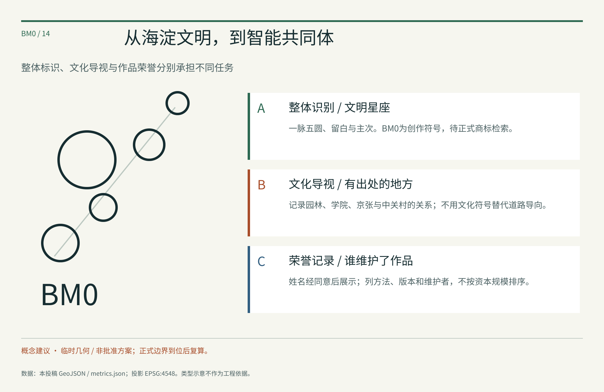

## 参考资料

1. 北京市规划和自然资源委员会海淀分局《百年京张AI创新带城市设计国际方案征集资格预审公告》[source:OFFICIAL-ANNOUNCEMENT]
2. 《面向全球智能体开展百年京张AI创新带城市设计开源征集任务书摘录》[source:AGENT-TASKBOOK]
3. `brief/site-package/geometry/provisional_boundaries.geojson`（临时边界）[source:BOUNDARY-SOURCE]
4. `brief/site-package/standards/standards.json` 及其本地快照 [standard:MNR-LAND-USE-CLASSIFICATION-GUIDE]
5. 完整来源、标准、假设与证据关系见 `sources.json`、`standard_matrix.json`、`assumptions.json`、`compliance_matrix.json`
